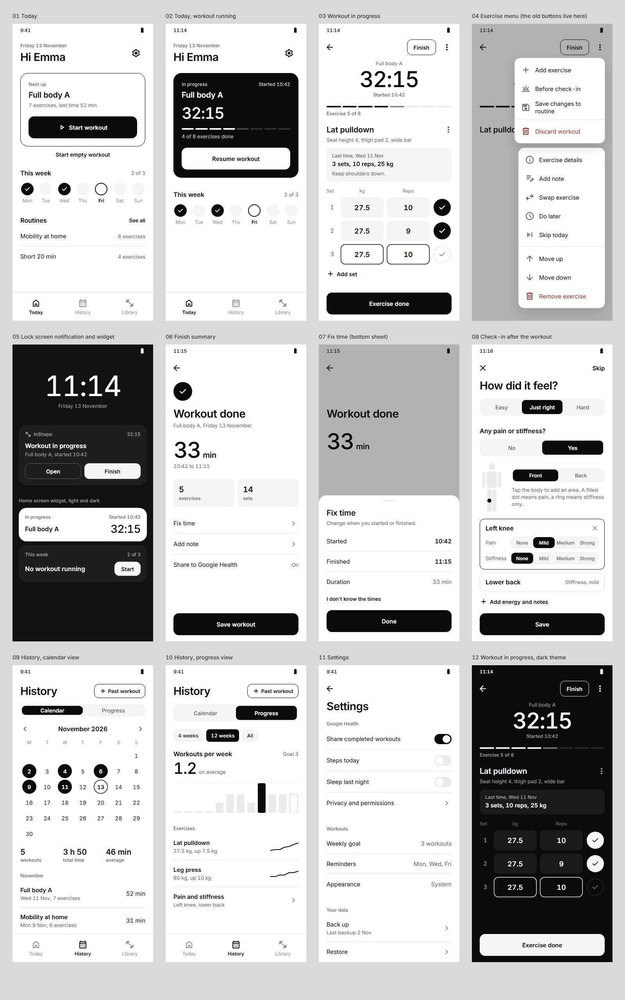

# InShape monochrome redesign and workout clock: implementation plan

Audience: the coding agent (Codex) implementing this change in `C:\Dev\InShape` (Kotlin, Jetpack Compose, Material 3, Room, Glance).

Read the whole file before editing anything. Every value you need is written here. The mockup images show the intended look. They are **directional, not pixel-perfect**: follow their layout, hierarchy, spacing rhythm and tone closely, but where an image and this text disagree, **this text wins**.

## 0. Ground rules

1. The app UI stays in **English**. All copy in this plan is the final English copy. Use sentence case everywhere (buttons, titles, labels, tabs).
2. **No data-layer redesign.** Do not change the Room schema, entities, migrations, backup format, export format, reminder logic or Health Connect sync logic. Everything here is presentation, navigation and one new notification. The only repository code you may add is small read helpers if a screen needs them.
3. **Health Connect stays.** The app writes completed workouts to Health Connect, and from there they reach Google Health. Keep every Health Connect setting and flow. The mockups say "Google Health" in two places. In the app, use **Health Connect** as the label (it is the platform name Android permission screens use). See section 7.6.
4. **No rest timer** between sets. Do not add one. **No pause button** for the workout clock in this iteration.
5. Forbidden UI patterns. They apply to every string, composable, widget and notification:
   - Never use `·`, `•` or ` | ` as separators between words, numbers or metadata. Separate with layout (opposite ends of a row, stacked lines, different weight or colour), or with a comma or parentheses inside a sentence.
   - Never add a coloured vertical bar on the left edge of a card, list row or panel.
6. Code quality rules from the owner:
   - No duplicates. Before writing new code, check whether equivalent logic exists. Extract any repeated 3+ line pattern into a shared function.
   - Every colour, size, radius and text style comes from the theme files in `ui/theme/`. No hard-coded values in screens.
   - One source of truth per concept (for example, elapsed-time formatting is defined once and used by the app, the notification and the widget).
   - Delete dead code in the same change. When you rename or move something, grep all callers and update them.
7. Do **not** commit, push or open a pull request. The owner reviews the working tree.
8. Do not run the owner's lint or security scripts (`lc`, `sc`). Run the Gradle build and tests listed in section 12.

## 1. Goals

1. **Workout clock.** When a workout starts, a large running clock is visible in the workout screen, on the Today card, in an ongoing notification (lock screen and status bar chip) and in the home-screen widget. Finishing stops it and saves the duration with no typing. Start and end times are already recorded automatically (`JournalRepository.startWorkout` sets `start`, `finishWorkout` sets `end`), so the clock is derived from `WorkoutEntity.start`. No schema change is needed.
2. **Simpler finish.** Replace the current "Review workout" form (YYYY-MM-DD text fields, UTC offset hints, checkbox) with a one-tap summary. Time correction moves behind a "Fix time" row with real time pickers.
3. **Less clutter.** One clear primary action per screen. Secondary actions move into overflow menus. Three bottom tabs instead of four.
4. **Lighter check-in.** "How did it feel?" plus an optional pain and stiffness map with four named levels instead of 0 to 10 scales.
5. **Monochrome visual language.** Black, white and greys only, with Inter as the single typeface. One muted red is kept for destructive actions and errors only.

## 2. Reference files

All paths are relative to `docs/redesign-monochrome/`.

- `mockups.html` is the source of the images. It renders in any browser. One CSS pixel equals one dp (the phone frame is 360 x 760 dp). Inline styles and the CSS variables at the top of the file carry exact values if you need to measure something.
- `screens/*.png` are 2x renders (720 x 1520 px) of each screen. `screens/00-overview.png` shows all of them side by side.
- `../../reports/emulator-screenshots/` shows the **current** app, for comparison.



Screen index (each is referenced again in its section):

1. `screens/01-today.png` Today with no active workout (section 6)
2. `screens/02-today-active.png` Today while a workout runs (section 6)
3. `screens/03-workout.png` Workout in progress (section 5.2)
4. `screens/04-workout-menus.png` Workout overflow menu and exercise menu, both shown open at once for illustration only (section 5.3)
5. `screens/05-lockscreen-widget.png` Ongoing notification on the lock screen, and the widget in its two states (sections 4.3 and 4.4)
6. `screens/06-finish.png` Finish summary (section 5.4)
7. `screens/07-fix-time.png` Fix time bottom sheet (section 5.5)
8. `screens/08-check-in.png` Check-in after the workout (section 8)
9. `screens/09-history.png` History, calendar view (section 7.1)
10. `screens/10-progress.png` History, progress view (section 7.2)
11. `screens/11-settings.png` Settings (section 7.6)
12. `screens/12-workout-dark.png` Workout in progress, dark theme (section 3.1)

## 3. Design system

Replace the contents of `ui/theme/` as described here. Keep the existing file split (`InShapeColors.kt`, `InShapeTheme.kt`, `Type.kt`, `Dimens.kt`, `Shapes.kt`). Then update `ui/components/` so every shared control uses the new tokens. Most screens should pick up the new look through the shared components; fix any screen that hard-codes something.

### 3.1 Colour

Monochrome. Hierarchy comes from ink versus surface, weight and size, never from hue.

```kotlin
@Immutable
data class InShapeColors(
    val isDark: Boolean,
    val background: Color,     // page and card background
    val surface: Color,        // inset fills: input cells, segmented track, metric tiles, "Last time" box
    val surfaceStrong: Color,  // pressed state, empty progress segments, body map base, chart bars
    val divider: Color,        // 1 dp hairlines between list rows, nav bar top border
    val outline: Color,        // 1 to 1.5 dp borders of outlined cards, current set cells, outline buttons
    val text: Color,           // primary text and icons
    val textSecondary: Color,  // supporting text, labels, metadata
    val textTertiary: Color,   // placeholders, unselected nav items, chevrons, disabled
    val ink: Color,            // filled primary button, selected segment, done check, workout days, chart highlight
    val onInk: Color,          // text and icons on ink
    val error: Color,          // destructive actions and error text only
    val scrim: Color           // behind bottom sheets and menus
)

val LightColors = InShapeColors(
    isDark = false,
    background = Color(0xFFFFFFFF),
    surface = Color(0xFFF4F4F4),
    surfaceStrong = Color(0xFFEBEBEB),
    divider = Color(0xFFE3E3E3),
    outline = Color(0xFF0B0B0B),
    text = Color(0xFF0B0B0B),
    textSecondary = Color(0xFF5E5E5E),
    textTertiary = Color(0xFF8E8E8E),
    ink = Color(0xFF0B0B0B),
    onInk = Color(0xFFFFFFFF),
    error = Color(0xFFB3261E),
    scrim = Color(0x520B0B0B)
)

val DarkColors = InShapeColors(
    isDark = true,
    background = Color(0xFF0B0B0B),
    surface = Color(0xFF1A1A1A),
    surfaceStrong = Color(0xFF242424),
    divider = Color(0xFF2A2A2A),
    outline = Color(0xFFF5F5F5),
    text = Color(0xFFF5F5F5),
    textSecondary = Color(0xFFA3A3A3),
    textTertiary = Color(0xFF6F6F6F),
    ink = Color(0xFFF5F5F5),
    onInk = Color(0xFF0B0B0B),
    error = Color(0xFFF2B8B5),
    scrim = Color(0x99000000)
)
```

Rules:

- Delete the old tokens (`accent`, `onAccent`, `onAccentMuted`, `onAccentInverse`, `accentContainer`, `onAccentContainer`, `mark`, `pain`, `stiffness`, `selected`, `muted`, `segmentTrack`, `surfaceInset`). Grep every usage and map it: accent fills become `ink`/`onInk`; accent containers become `surface`; `mark` becomes `ink`; `muted` becomes `textTertiary` or `surfaceStrong` depending on use.
- Pain and stiffness are distinguished by **shape, not colour**: pain is a filled mark or solid line, stiffness is a ring or dashed line (charts already use solid versus dashed; keep that).
- `textTertiary` fails text contrast on small text. Use it only for icons, chevrons, placeholders and unselected navigation labels, never for information the user must read.
- Map to the Material `ColorScheme` in `InShapeTheme.kt`: `primary = ink`, `onPrimary = onInk`, `primaryContainer = surface`, `onPrimaryContainer = text`, `secondary = textSecondary`, `onSecondary = background`, `secondaryContainer = surface`, `onSecondaryContainer = text`, `tertiary = text`, `background` and `surface` and every `surfaceContainer*` except Highest `= background`, `surfaceContainerHighest = surface`, `surfaceVariant = surface`, `onSurfaceVariant = textSecondary`, `outline = outline`, `outlineVariant = divider`, `error = error`, `scrim = scrim`, `surfaceTint = Transparent`.
- System bars stay transparent with dark icons on light and light icons on dark, as today.

### 3.2 Elevation

No shadows anywhere. Delete `Modifier.cardElevation` and its usages. Depth comes from three things only: an outlined card (1 dp `outline` border), an inset fill (`surface`), or a hairline (`divider`). Bottom sheets and menus sit on a `scrim`. Menus get a 1 dp `divider` border instead of a shadow.

### 3.3 Typography

One typeface: **Inter** (SIL Open Font License), variable font, bundled as `res/font/inter.ttf`.

- Get it from the official Google Fonts repository (`github.com/google/fonts`, folder `ofl/inter`, file `Inter[opsz,wght].ttf`). Verify the current file name there before downloading. Rename it to `inter.ttf`.
- Add the licence as `docs/redesign-monochrome/OFL-Inter.txt`. Delete `res/font/space_grotesk.ttf` and `docs/redesign/OFL-SpaceGrotesk.txt`, and remove every reference to Space Grotesk (including the README).
- Declare the family the way `Type.kt` already declares Space Grotesk, with `FontVariation.Settings(FontVariation.weight(n))` for 400, 500 and 600.
- **Tabular figures** on every style that shows changing numbers, so the clock does not jitter: `fontFeatureSettings = "tnum"`. Apply it to all styles below for simplicity.
- Weights: 400, 500 and 600 only. No 700.

Type scale (size / line height in sp, weight, letter spacing):

```kotlin
val AppTypography = Typography(
    displayLarge   = style(56, 60, W500, -0.03f),  // workout clock, finish duration number
    displaySmall   = style(40, 44, W500, -0.03f),  // clock on the Today card, big averages in Progress
    headlineMedium = style(28, 34, W600, -0.02f),  // screen titles: "Hi Emma", "History", "Workout done", "How did it feel?"
    titleLarge     = style(20, 26, W600, -0.01f),  // exercise name, sheet title, routine name in hero card, metric numbers
    titleMedium    = style(16, 22, W600),          // section titles ("This week", "Routines"), area names
    bodyLarge      = style(15, 22, W400),          // list rows, body copy
    bodyMedium     = style(13, 18, W400),          // supporting text, metadata lines
    labelLarge     = style(15, 20, W600),          // button text, text actions
    labelMedium    = style(14, 20, W500),          // segmented control, chips
    labelSmall     = style(12, 16, W500, 0.01f)    // captions above values, nav labels, table headers
)
```

`InShapeType` keeps only what screens still need: `setValue` (18/24, W600) for the kg and reps cells, `nav` (`labelSmall`, W400) and `navSelected` (`labelSmall`, W600). Delete the rest after replacing their uses with the scale above. No `labelSmall` with wide letter spacing or uppercase: section labels are sentence case.

### 3.4 Spacing and sizing

A 4 dp grid. Replace `Dimens.kt` values (keep names where they still fit, delete unused ones):

- Screen horizontal padding: 20
- Space between sections: 32 (between a section and the next section title)
- Space inside a group: 12 (title to its content, between cards in a stack)
- Small gaps: 8 and 4
- Card padding: 20; inset box padding: 12 vertical, 14 horizontal
- List row: minimum height 52, vertical padding 14, 1 dp `divider` between rows, no divider after the last row, no horizontal padding (rows align with the screen padding)
- Primary button height: 56. Outline button height: 40 (36 in tight headers). Text actions: 48 touch target.
- Set row: number column 28, value cells 52 high, check button 44 (inside a 48 touch target), 8 between columns, 8 between rows
- Segmented control: 44 high with 4 inner padding (32 high with 2 inner padding for compact use inside cards)
- Week dots: 32 circles, 36 column. Calendar: 36 visual circle inside a 48 touch target
- Bottom navigation: 72 high, 1 dp `divider` top border
- Icons: 24 default, 20 inside buttons, 18 inside small circles
- Minimum touch target 48 everywhere

### 3.5 Shapes

```kotlin
object InShapeShapes {
    val chip = RoundedCornerShape(8.dp)      // filter chips, small level chips
    val field = RoundedCornerShape(12.dp)    // text fields, set cells, inset boxes, segmented track, menus' items area
    val button = RoundedCornerShape(14.dp)   // primary and outline buttons
    val card = RoundedCornerShape(20.dp)     // outlined cards, hero card, bottom sheet top corners, menus
    val pill = CircleShape                   // check buttons, week dots, calendar days
}
```

Segment inside a segmented control: 9 dp radius (track radius 12 minus 3 inset is fine to derive in code).

### 3.6 Shared components (`ui/components/`)

Restyle, do not multiply. Where two components now look the same, merge them and update callers.

- `PrimaryButton`: `ink` fill, `onInk` label (`labelLarge`), 56 high, `button` shape, optional leading icon 20 dp. Disabled: `surfaceStrong` fill, `textTertiary` label.
- `HeroButton`: same as `PrimaryButton`, plus an inverted variant (`onInk` fill, `ink` label) for use on the ink hero card. If it is now identical to `PrimaryButton` apart from colours, make it a parameter of `PrimaryButton` and delete `HeroButton`.
- `SecondaryButton` and `OutlineButton`: one outline style, 1 dp `outline` border, transparent fill, `text` label. Merge them if they end up identical.
- `TextAction`: `labelLarge`, `text` colour (not accent), optional leading icon. Destructive variant uses `error`.
- `InShapeCard`: no shadow. Two variants: `Outlined` (1 dp `outline` border, `background` fill, `card` shape, 20 padding) and `Inset` (`surface` fill, `field` shape, no border). Most former cards become plain sections with no container at all; only the hero card on Today, the area cards in check-in and the inset "Last time" box keep a container.
- `ListCard` and `ListRow`: no card background or border. Rows separated by `divider` hairlines. Title `bodyLarge`, subtitle `bodyMedium` `textSecondary`, trailing value `bodyMedium` `textSecondary`, chevron `textTertiary`.
- `SectionLabel`: `titleMedium` in `text` for section titles on main screens, and a quieter variant (`labelSmall`, `textSecondary`) for group captions inside Settings and lists ("Health Connect", "Your data", "November"). Optional trailing action ("See all") in `labelLarge`.
- `SegmentedControl`: `surface` track, selected segment `ink` with `onInk` text in W600, unselected `textSecondary`.
- `FilterPill` / `Pill`: `chip` shape, 32 high, `surface` fill and `text` label; selected is `ink` fill with `onInk`.
- `InShapeSwitch`: on = `ink` track and `onInk` thumb; off = `surfaceStrong` track and `background` thumb with a 1 dp `divider` ring. No icon in the thumb.
- `ProgressSegments`: 4 dp high, 4 dp gaps, 2 dp radius. Done = `ink`, current = `textTertiary`, pending = `surfaceStrong`. Inverted variant for the ink hero card: done = `onInk`, others = 50% and 35% of `textTertiary`.
- `TextField` and `NumberField`: `surface` fill, no underline, `field` shape, 1.5 dp `outline` border when focused, label in `textSecondary`.
- `EmptyState`: title `titleMedium`, message `bodyMedium` `textSecondary`, optional outline button. No card.
- `ConfirmDialog`: `background` container, `card` shape, title `titleLarge`, confirm button `ink` (or `error` text for destructive confirms).
- `SaveStatus`: inset style; error text in `error`.
- `DateTile` and `InitialsTile`: `surface` fill, `text` content. If they are no longer used after section 7, delete them.

## 4. Workout clock

### 4.1 Single source of truth

Create `ui/theme/ElapsedTime.kt` (or put it next to the existing date formatters) with:

```kotlin
/** Whole seconds between start and now, never negative. */
fun elapsedSeconds(start: Instant, now: Instant): Long

/** "05:07", "32:15", "1:04:09". Matches android.widget.Chronometer's default format so app, notification and widget agree. */
fun formatElapsed(seconds: Long): String

/** "33 min", "1 h 5 min". For saved durations. Reuse or replace any existing duration formatter (grep for "h " and " min" builders in History and Progress) so there is only one. */
fun formatDuration(seconds: Long): String
```

Unit-test all three (0 s, 59 s, 60 s, 3599 s, 3600 s, 36 000 s, negative interval).

A composable `rememberElapsedSeconds(start: Instant?, clock: Clock): State<Long?>` ticks once per second while it is in composition: `produceState`, loop with `delay(1000 - now.toEpochMilli() % 1000)` so the display changes on the second boundary. It returns `null` when `start` is null. Use the injected `container.clock`, never `Instant.now()`, so demo fixtures and tests can fix the time.

### 4.2 Where the clock is shown in the app

- Workout screen header (section 5.2), `displayLarge`.
- Today hero card while a workout is active (section 6), `displaySmall`.

When `WorkoutEntity.timingNeedsReview` is true (the workout was resumed on a later date), do not show a running clock. Show "Started Thu 12 Nov" in its place (`bodyMedium`, `textSecondary`). Finishing such a workout goes through the full timing editor (section 5.6).

### 4.3 Ongoing notification

New class `workout/ActiveWorkoutNotifier.kt` (new package `com.emmah.inshape.workout`, or under `feature/workout` if you prefer; keep it out of `reminders`). Look at `screens/05-lockscreen-widget.png`.

Behaviour:

- Shown while a workout is active (`snapshot.active != null`) and `timingNeedsReview` is false. Removed when the workout is finished, discarded or deleted, and when `timingNeedsReview` becomes true.
- Drive it from `AppContainer`, inside the existing `if (integrationsEnabled)` block, the same way the widget is driven: collect `repository.changes`, map to `active?.let { ActiveNotice(it.row.id, it.row.title, it.row.start, it.row.timingNeedsReview) }`, `distinctUntilChanged()`, then post or cancel. Also call the reconcile function from `AppContainer.onForeground()` and from `ScheduleChangeReceiver` (boot, package replaced, time and time zone changes), so the notification comes back after a reboot. Demo mode (`integrationsEnabled == false`) must never post it.
- If the user dismisses it (Android 14+ allows dismissing ongoing notifications), do not post it again for the same workout id. Use `setDeleteIntent` to a small non-exported receiver that stores the dismissed workout id in the `ui_settings` SharedPreferences (the same non-journal store `ThemeSettings` uses; it must not go into backups). A new workout id clears it.

Channel:

- Id `active_workout`, name "Workout in progress", importance `IMPORTANCE_LOW` (silent, no heads-up; must not be `IMPORTANCE_MIN`, which blocks promotion), no badge.

Content (platform `Notification.Builder`, like `ReminderScheduler` uses):

- Small icon: a new monochrome vector `res/drawable/ic_stat_workout.xml` (a dumbbell, 24 dp, white fill, transparent background). Do not use the launcher icon.
- Title: "Workout in progress". Text: "{title}, started {HH:mm}" (for example "Full body A, started 10:42"). Use 24-hour or 12-hour time according to `DateFormat.is24HourFormat(context)`.
- `setWhen(startEpochMillis)`, `setShowWhen(true)`, `setUsesChronometer(true)`. The system draws the running timer; do not post updates every second.
- `setOngoing(true)`, `setOnlyAlertOnce(true)`, `setCategory(Notification.CATEGORY_WORKOUT)`, `setVisibility(Notification.VISIBILITY_PUBLIC)` (the content is not sensitive), `setLocalOnly(false)`.
- Content intent: open the workout (`MainActivity` with a new action `OPEN_WORKOUT`).
- Actions: "Open" (same as content intent) and "Finish" (`MainActivity` with a new action `OPEN_FINISH`). "Finish" opens the finish summary (section 5.4). It does **not** finish the workout silently, because finishing can fail validation ("Nothing recorded yet") and the user should see the summary.
- Do not colourise, do not use a custom `RemoteViews` layout, do not make it a group summary. These would block promotion.

Live Update (status bar chip) on Android 16 and later:

- Add `<uses-permission android:name="android.permission.POST_PROMOTED_NOTIFICATIONS" />` to the manifest (normal permission, no runtime prompt).
- On API 36+ call `builder.setRequestPromotedOngoing(true)`. Guard with `Build.VERSION.SDK_INT >= Build.VERSION_CODES.BAKLAVA`. Check the method name in the current `Notification.Builder` reference before using it; the official guide is https://developer.android.com/develop/ui/views/notifications/live-update . A workout the user started is an explicitly listed appropriate use.
- Nothing else changes when promotion is unavailable or the user turned it off; the notification still works as a normal ongoing one.

Notification permission (API 33+):

- `POST_NOTIFICATIONS` is already declared. The first time the user starts a workout and the permission is not granted, request it once with the Activity Result API from the Today or Workout screen. Store "asked" in `ui_settings` SharedPreferences and never ask again automatically. If denied, everything else works; the clock is still in the app and the widget. If the reminders feature already has a permission helper, reuse it instead of writing a second one.

`MainActivity`:

- Add `OPEN_WORKOUT` and `OPEN_FINISH` next to `START_OR_RESUME` and `OPEN_TODAY`, accept them in `acceptIntent` under the same rules, and handle them in `AppNavigation`'s `entryAction` effect: navigate to `workout/{activeId}` or `finish/{activeId}`. If no workout is active any more, go to Today.

### 4.4 Widget

Restyle `widget/InShapeWidget.kt` to the monochrome palette (see `screens/05-lockscreen-widget.png`, bottom). Use the same colour values as `LightColors` and `DarkColors`; import them, do not retype hex values. Background `background` (dark uses `surface`, `#1A1A1A`, so it separates from dark wallpapers), primary text `text`, secondary `textSecondary`, button `ink` with `onInk` label, corner radius 20 dp.

Two states:

- **Active workout**: first row "In progress" at the start and "Started 10:42" at the end (`labelSmall`-sized, secondary). Second row: workout title at the start (16 sp, W600) and a running timer at the end (28 sp). Tapping the widget opens the workout.
- **No active workout**: first row "This week" and "2 of 3" (or "2 workouts" with no goal). Second row: "No workout running" and a compact "Start" button. Keep the existing `START_OR_RESUME` action.

Running timer in the widget: Glance has no chronometer composable. Host a classic `RemoteViews` with an `android.widget.Chronometer` inside Glance using `AndroidRemoteViews`. Add a tiny layout `res/layout/widget_chronometer.xml` containing only the `Chronometer`, set text size and colour there, and call `setChronometer(id, base, null, true)` with `base = SystemClock.elapsedRealtime() - (now - startMillis)`. The chronometer ticks by itself; do not schedule frequent widget updates. If `AndroidRemoteViews` turns out not to work on the target Glance version (`glance-appwidget 1.2.0`), fall back to showing "Started 10:42" without a running timer and say so in your final report.

`widgetState(...)` needs the active workout's start instant and title; extend it and its unit test.

## 5. Workout flow

### 5.1 Navigation changes for the workout

- The workout screen draws its own top bar. Add `route.startsWith("workout/")` to the list of routes for which `AppNavigation`'s Scaffold shows no `TopAppBar` (it already does this for `checkin/` and `exercise/`). Delete the now-unused "Started HH:mm" subtitle code and the "Finish" action from `AppNavigation`.
- New route `finish/{id}` for the finish summary (section 5.4).
- The workout "Finish" action goes to `finish/{id}` when `timingNeedsReview` is false, and to the existing `timing/{id}/finish` when it is true.

### 5.2 Workout screen

Look at `screens/03-workout.png` (light) and `screens/12-workout-dark.png` (dark).

Top bar (56 dp, no title): back arrow at the start. At the end: an outline button "Finish" (40 dp high) and an overflow icon (`MoreVert`) that opens the workout menu (section 5.3).

Header, centred:

1. Workout title, `bodyMedium`, `textSecondary` (for example "Full body A").
2. Running clock, `displayLarge`, `text` (section 4).
3. "Started 10:42", `labelSmall`, `textSecondary`.

Then, left-aligned:

4. `ProgressSegments` across the full width, 20 dp below the header.
5. "Exercise 5 of 8" (`labelSmall`, `textSecondary`), 8 dp below. The number is the current item's position among all items. When there is no current item, show "All exercises done".

Current exercise, with **no card container**, 20 dp below:

6. Row: exercise name (`titleLarge`) at the start, overflow icon at the end (opens the exercise menu, section 5.3). Remove the "Details" text action; it moves into the menu.
7. Machine settings as **one line of text** (`bodyMedium`, `textSecondary`), the setup values joined with ", " (for example "Seat height 4, thigh pad 2, wide bar"). Remove the setup pills. Hide the line when there is no setup.
8. "Last time" inset box (`surface`, `field` shape), 12 dp below, only when a previous record exists (hide it entirely otherwise; delete the "No previous record" state):
   - "Last time, Wed 11 Nov" (`labelSmall`, `textSecondary`)
   - summary from `itemSummary(...)` (`bodyLarge`, W600)
   - previous note if any (`bodyMedium`, `textSecondary`), **without** the "Your note:" prefix
9. Set table, 16 dp below. Header row ("Set", the basis unit such as "kg", "Reps") in `labelSmall`, `textTertiary`. Rows per section 3.4. Value cells use `InShapeType.setValue`.
   - Completed set: cells `surface` fill, check button filled `ink` with `onInk` check icon.
   - The first incomplete set (currently `highlighted`): cells `background` fill with a 1.5 dp `outline` border; check button with a 1.5 dp `divider` ring and a `textTertiary` check icon.
   - Other incomplete sets: cells `surface`, check button as above.
10. "Add set" text action with a leading plus icon, 14 dp below.
11. Duration field ("Performed minutes (optional)") only for duration-mode items or items with no sets, as today.
12. Exercise note: if the item has a note, show it under the sets as `bodyMedium` text; tapping it opens the note editor (the existing note field and "This movement felt uncomfortable" checkbox). The editor is opened from the exercise menu "Add note" (label "Edit note" when a note exists). Remove the "Add note", "Swap" and "Do later" button row and the "Skip today" text action from the body.

Below the current exercise, separated by 32 dp:

13. "Up next" section title and a hairline list of pending items (name at the start, "3 sets", "10 min" or "Completion only" at the end). Tapping a row makes it the current item if the repository already supports that; otherwise rows are not clickable.
14. "Done" section and hairline list. The trailing reopen control becomes a filled `ink` check circle (24 dp) with content description "Reopen {name}".
15. "Skipped" section and list, unchanged in content, restyled.

Removed from the screen body (moved, not deleted as features): "Add exercise" button, workout note field, "Workout check-in" row, "Save changes to routine" button, "Discard workout" action, the timing-needs-review card (its message moves into the header, section 4.2).

Pinned bottom button (existing `Page(bottomBar = ...)`), 56 dp, full width, 16 dp above the system navigation bar:

- "Exercise done" when there is a current item (calls the existing `markItemDone`; same validation as today's "Mark done").
- "Finish workout" when there is no current item (same destination as the top bar "Finish").

### 5.3 Menus

Look at `screens/04-workout-menus.png`. The image shows both menus open together only to save space; at runtime only one is open.

Workout menu (top bar overflow), in this order:

1. "Add exercise" (opens the existing exercise picker sheet)
2. "Before check-in" (navigates to `checkin/{id}/BEFORE`)
3. "Save changes to routine" (only when the workout came from a routine that still exists; existing confirm dialog)
4. divider
5. "Discard workout" in `error` colour (existing confirm dialog)

Exercise menu (overflow next to the exercise name), in this order:

1. "Exercise details"
2. "Add note" or "Edit note"
3. "Swap exercise" (existing alternatives sheet)
4. "Do later"
5. "Skip today"
6. divider
7. "Move up" (disabled at the top)
8. "Move down" (disabled at the bottom)
9. "Remove exercise" in `error` colour (existing confirm when work is recorded)

Every item has a 24 dp outlined leading icon in `textSecondary` (destructive items: `error`). Suggested Material icons: `Info`, `EditNote`, `SwapHoriz`, `Schedule`, `SkipNext`, `ArrowUpward`, `ArrowDownward`, `Delete`, `Add`, `WbTwilight`, `Save`. Menu container: `background`, `card` shape, 1 dp `divider` border, no shadow, items 48 dp high, 16 dp horizontal padding, `bodyLarge` text.

### 5.4 Finish summary (new screen)

Look at `screens/06-finish.png`. New composable `feature/workout/FinishScreen.kt`, route `finish/{id}`.

Capturing the end time:

- The end time is the moment the user pressed "Finish", not the moment they press "Save". On first entry, store the current instant from `container.clock` in an editor draft with id `finish:{id}` (use the existing `vm.saveDraft` / `data.drafts` mechanism, as `WorkoutTimingEditor` does for `timing:{id}`), so rotation and process death keep it. If the draft exists, reuse it. Delete the draft on save and when the user leaves with back (going back to the workout means the workout continues and a later Finish captures a new end time).

Layout, top to bottom (screen padding 20):

1. Top bar with a back arrow only.
2. A 48 dp `ink` circle with an `onInk` check icon, 8 dp below the bar.
3. "Workout done" (`headlineMedium`), 16 dp below.
4. "{title}, {Friday 13 November}" (`bodyMedium`, `textSecondary`), 4 dp below.
5. Duration, 24 dp below: the number in `displayLarge` and the unit "min" in `titleLarge`, baseline-aligned, 6 dp apart. For 60 minutes or more show "1 h 5 min" with the same two-size treatment ("1" and "5" large, "h" and "min" small). Under one minute show "Under 1 min" in `titleLarge`.
6. "10:42 to 11:15" (`bodyMedium`, `textSecondary`). If start and end fall on different dates, include the weekday: "Thu 22:50 to Fri 00:20".
7. Two metric tiles side by side (`surface`, `field` shape, 14 padding, 8 gap), 24 dp below: number in `titleLarge`, caption in `labelSmall` `textSecondary`. Left: performed exercises (`workout.performedCount`), caption "exercises" (singular "exercise" for 1). Right: completed sets across all items, caption "sets".
8. Hairline list, 16 dp below:
   - "Fix time" with a chevron. Opens the bottom sheet in section 5.5.
   - "Add note" with a chevron. Expands an inline multi-line text field for the workout note (prefilled with the existing note; the label changes to "Note" when it has text). Saved on "Save workout".
   - "Share to Health Connect" with trailing "On" or "Off" from `preferences.shareWorkouts`. Tapping opens Settings. When sharing is on but the times are unknown (section 5.5), the trailing text is "Off for this workout" because unconfirmed timing is never shared.
9. Pinned bottom "Save workout" (`PrimaryButton`).

Save:

```kotlin
vm.write {
    if (noteChanged) saveWorkoutNote(id, note)
    finishWorkout(
        id,
        WorkoutTiming(
            start = fixedStart?.toString(),        // null unless the user fixed it, so the recorded start is kept
            end = endInstant.toString(),           // from the finish:{id} draft or the user's fix
            acknowledged = true,                   // REQUIRED: Health Connect sharing needs timingConfirmed
            clearTimes = unknownTimes,
            durationSeconds = manualDurationSeconds, // only when unknownTimes and the user typed minutes
            inferDuration = !unknownTimes
        )
    )
    deleteEditorDraft("finish:$id")
}
```

Then navigate to `detail/{id}` with `popUpTo("workout/{id}") { inclusive = true }`, and immediately navigate on to `checkin/{id}/AFTER`, so closing or skipping the check-in lands on the workout details.

`acknowledged = true` matters: `JournalRepository.finishWorkout` sets `timingConfirmed` only when timing is acknowledged and both times exist, and `changed(...)` only shares confirmed workouts to Health Connect.

Nothing recorded: if `!workout.hasPerformedWork && note.isBlank()`, `finishWorkout` would throw. Show instead, under the title, "Nothing recorded yet" (`titleMedium`) and "Complete at least one set, mark an exercise done or add a note." (`bodyMedium`, `textSecondary`), hide the duration and tiles, and replace the bottom button with "Back to workout" plus a destructive text action "Discard workout" (existing confirm dialog).

### 5.5 Fix time bottom sheet

Look at `screens/07-fix-time.png`. A `ModalBottomSheet` (`background` container, `card` top corners, `scrim`), 20 padding:

1. Drag handle (32 x 4, `surfaceStrong`).
2. "Fix time" (`titleLarge`) and "Change when you started or finished." (`bodyMedium`, `textSecondary`).
3. Hairline rows: "Started" with the time at the end (`bodyLarge` W600), "Finished" with the time at the end, "Duration" with the computed duration at the end (`textSecondary`, not tappable). When the interval crosses midnight, show the weekday before the time ("Thu 22:50").
4. Tapping "Started" or "Finished" opens a Material 3 `TimePicker` dialog (`is24Hour` from `DateFormat.is24HourFormat`). Dates are derived, not typed: the start keeps the recorded start date; the end uses the start date, or the next day if the chosen end time is earlier than the start time. Use `resolveRecordedTime(dateText, "HH:mm", zone, originalInstant)` so unedited values keep their original precision. If it throws (a time skipped or repeated by a daylight-saving change), show its message under the row in `error` and keep the sheet open.
5. Text action "I don't know the times". When chosen: the rows show "Not recorded", a `NumberField` "Duration in minutes (optional)" appears, and a note in `bodyMedium` `textSecondary` says "Workouts without times aren't shared to Health Connect." The action changes to "Use recorded times" to undo.
6. "Done" (`PrimaryButton`) closes the sheet and updates the summary. Validation: the end must be after the start, otherwise show "The finish time must be after the start time." under "Finished".

### 5.6 Timing editor for corrections and resumed workouts

`WorkoutTimingEditor` stays for the routes `timing/{id}/correct` (from History details) and `timing/{id}/finish` (only when `timingNeedsReview`). Restyle it and simplify input:

- Replace the "YYYY-MM-DD" and "HH:mm" text fields with rows that open Material 3 `DatePicker` and `TimePicker` dialogs (same row pattern as section 5.5). Keep the workout name and note text fields.
- Delete the paragraph about seconds and UTC offsets, and the "Time zone: ..." line. Show the time zone only when it differs from the device's current zone, as "Recorded in Europe/Helsinki" (`bodyMedium`, `textSecondary`).
- Replace the "Start and end times are not recorded" checkbox with the same "I don't know the times" text action as section 5.5.
- Keep the stale-draft card, restyled as an inset box.
- The `TimingDraft` serialised format must stay readable (drafts may exist on the owner's phone). Keep the same fields and string formats; only the input method changes.

## 6. Today screen

Look at `screens/01-today.png` and `screens/02-today-active.png`.

Header (16 dp below the status bar): date "Friday 13 November" (`labelSmall`, `textSecondary`), greeting "Hi Emma" (`headlineMedium`, 4 dp below; "Hello" when no name is set, as today). Settings icon button at the end of the row.

Hero card, 24 dp below the header. Three states:

1. **Workout active**: an `ink`-filled card (`card` shape, 20 padding), all text in `onInk` (secondary text at 72% alpha of `onInk`). Row: "In progress" at the start, "Started 10:42" at the end (`labelSmall`). Title (`titleLarge`). Running clock (`displaySmall`), 12 dp below. Inverted `ProgressSegments`, 16 dp below. "4 of 8 exercises done" (`bodyMedium`), 8 dp below. Inverted primary button "Resume workout", 20 dp below. If `timingNeedsReview`, replace the clock with "Started Thu 12 Nov".
2. **Routine suggestion** (existing "least recently completed routine" logic): outlined card. "Next up" (`labelSmall`, `textSecondary`), routine title (`titleLarge`, 6 dp below), meta line (`bodyMedium`, `textSecondary`, 4 dp below): keep today's text built from the routine's exercise count and `routine.durationMinutes` ("7 exercises, about 45 min"); omit the duration part when it is null. The mockup shows "last time 52 min"; ignore that, use the existing data. Primary button "Start workout" with a play icon, 20 dp below. Under the card, centred, a text action "Start empty workout" (12 dp below the card). This replaces today's "Empty workout" and "Repeat last" secondary buttons. "Repeat last" is removed from Today; repeating stays available as "Repeat workout" on the workout details screen.
3. **No routines**: outlined card with "Ready when you are", "Start a workout", "Add exercises as you go" and the "Start workout" button (empty workout). No "Start empty workout" link.

"This week", 28 to 32 dp below: title (`titleMedium`) at the start and "2 of 3" (or "2 workouts" with no goal) at the end in `bodyMedium` `textSecondary`. Seven day dots, 14 dp below, spread across the width: completed days `ink` with an `onInk` check, today a 2 dp `outline` ring with a W600 label, other days `surface`. Labels "Mon" to "Sun" in `labelSmall` `textTertiary`.

"Routines", 32 dp below: title at the start, "See all" text action at the end (opens Library). Hairline list of up to three other routines: name at the start, "6 exercises" at the end. Tapping a row starts that routine, as it does today (`onStart(StartSource.Routine(id))`); keep that behaviour. With no routines, show one row "Create a routine" with a chevron that opens Library, and delete the "A plan that fits you" card.

"Last workout" stays as one hairline row ("Full body A" with "Wed 11 Nov" below, "52 min" at the end) opening the workout details.

`HealthToday` (steps, sleep, heart rate from Health Connect) stays at the bottom as hairline rows, restyled. Do not change its logic.

## 7. Other screens

### 7.1 Bottom navigation and History

Three tabs: **Today**, **History**, **Library** (`Home`, `CalendarMonth`, `FitnessCenter` outlined icons). Progress becomes a view inside History.

- `NavigationBar`: `background` container, 1 dp `divider` top border (already there), 72 dp high, **no indicator pill** (`indicatorColor = Transparent`). Selected icon and label `text` with `InShapeType.navSelected`; unselected `textTertiary` with `InShapeType.nav`.
- Update `Destination`, `tabs`, `labels`, `icons` in `AppNavigation`. Remove `R.string.progress` if unused.
- New History route: `History?view={view}&exercise={exercise}` with `view` = `calendar` (default) or `progress`. Replace the `Progress` and `Progress?exercise={exercise}` routes. The exercise screen's "progress" link (`nav.navigate("Progress?exercise=$id")`) becomes `History?view=progress&exercise=$id`. Treat both History routes as the History tab for selection and `isMain`.

History screen (`screens/09-history.png`):

1. Header row: "History" (`headlineMedium`) at the start, compact outline button "Past workout" with a plus icon (36 dp high) at the end.
2. `SegmentedControl` "Calendar" and "Progress", 16 dp below. Remember the selection with `rememberSaveable`.
3. Calendar view:
   - Month row: chevron buttons at both ends, "November 2026" (`titleMedium`) centred.
   - Weekday initials (`labelSmall`, `textTertiary`), then the month grid. Workout days: `ink` circle with `onInk` W600 number. Today: 1.5 dp `outline` ring, W600. Other days: plain `text`. Keep the existing date picker behaviour on tap.
   - Delete the legend ("Workout", "Today") if the meaning is obvious without it; keep it only if a test or accessibility label depends on it, restyled as plain text.
   - Month summary as three plain columns (no cards, no dividers between them): number in `titleLarge`, caption in `labelSmall` `textSecondary`: "workouts", "total time", "average" (average duration of workouts with a known duration; hide the column when none). Replace the old "average effort" column.
   - "November" group caption, then a hairline list of the month's workouts: title (`bodyLarge` W600) and "Wed 11 Nov, 7 exercises" (`bodyMedium` `textSecondary`) stacked at the start, duration at the end. Remove the date tiles and the effort pill.

### 7.2 Progress view

`screens/10-progress.png`. Move the content of `ProgressScreen` into the History screen's Progress view. Remove its own screen title. Keep all calculations (`ProgressCalculator`) unchanged.

- Range chips "4 weeks", "12 weeks", "All" as `FilterPill`s in a row (not a segmented control), 20 dp below the segmented control.
- "Workouts per week": title at the start, "Goal 3" at the end (`bodyMedium` `textSecondary`). Average in `displaySmall` with "on average" in `bodyMedium` `textSecondary`. Bar chart: past weeks `surfaceStrong`, weeks that met the goal `ink`, the current week a dashed `textTertiary` outline, the goal as a dashed `divider` line, empty weeks a 4 dp stub. Keep "View weekly counts" as a text action if it exists for accessibility.
- "Exercises" group: hairline rows with the exercise name (`bodyLarge` W600), the latest value and change ("27.5 kg, up 7.5 kg") in `bodyMedium` `textSecondary`, and a 72 x 28 dp sparkline (2 dp `ink` stroke, round joins) at the end. Tapping a row opens the existing per-exercise detail (weight, reps, sets, comparison) restyled with the same tokens.
- "Pain and stiffness" row opens the existing body observation charts (pain solid line, stiffness dashed line, both `ink`).

### 7.3 Library

Restyle only, no behaviour change, except one: show **one** create action per tab in the header (an outline button "New routine" or "New exercise" with a plus icon) and delete duplicate create buttons. Lists become hairline rows. Filters become `FilterPill`s.

### 7.4 Exercise details and exercise editor

Exercise details: restyle. Machine setup appears as stacked label and value rows (label `bodyMedium` `textSecondary` at the start, value `bodyLarge` at the end), not pills. Photos stay prominent; they help find the right machine.

Exercise editor: keep all fields but show only the essentials by default:

- Always visible: "Exercise name", "Machine settings" (the label and value pairs), "Measurement".
- Under a collapsed row "More details" (chevron, `bodyLarge`, opens inline): "Nickname (optional)", "Type", "Muscles or labels", "Location", "Recognizable machine name", "Links", "Alternatives", "Personal notes" and "My instructions". When any of these has a value, the collapsed row shows a one-line summary below it in `bodyMedium` `textSecondary` (for example "Machine, gym, 2 links"), using commas.
- Remove the uppercase group captions ("BASICS", "WHERE", "MEASUREMENT"); use sentence-case `labelSmall` captions only where grouping helps.
- "Archive exercise" stays at the bottom as a destructive text action.

### 7.5 Routine editor

Restyle only. Hairline rows for exercises, one primary action at the bottom ("Save routine"), destructive actions as `error` text actions.

### 7.6 Settings

`screens/11-settings.png`. Keep every setting and its logic. Restyle and regroup:

1. Title "Settings" (`headlineMedium`) under the back arrow.
2. Group "Health Connect" (the mockup says "Google Health"; use "Health Connect"): "Share completed workouts", "Steps today", "Sleep last night", "Latest heart rate" as switch rows, then "Privacy and permissions" with a chevron. Keep the explanatory footnotes as short `bodyMedium` `textSecondary` text below the group, including "Health Connect is unavailable on this device." when applicable. Add one footnote: "Completed workouts appear in Google Health and other apps connected to Health Connect."
3. Group "Workouts": name, weekly goal, reminders (days and time), appearance (System, Light, Dark). Each row shows its current value at the end in `textSecondary`; tapping edits it the way it does today.
4. Group "Your data": "Back up" (subtitle "Last backup 2 Nov" or "No backup yet"), "Restore", "Export CSV or PDF", "Home screen widget" (subtitle "Not placed yet" or "Placed").
5. Group captions use the quiet `SectionLabel` variant. Groups are separated by 32 dp. No cards.

### 7.7 Workout details (History)

Restyle with hairline rows. It is now the landing page after finishing, so its top shows: title (`headlineMedium`), date, duration in `displaySmall`, the two metric tiles from section 5.4, then exercises, then a "Check-ins" group with rows "Before workout", "After workout" and "Next day", each showing a short summary at the end ("Just right", "Mild knee pain") or "Add" in `textSecondary`. The existing "Correct date, timing or note" button becomes a hairline row "Fix time or note" that opens `timing/{id}/correct`. "Repeat workout" (it exists today) stays as the primary bottom action.

## 8. Check-in

`screens/08-check-in.png`. Keep the data model (`CheckIn.effort` 0 to 10, `CheckIn.energy`, `BodyObservation.pain` and `stiffness` 0 to 10, missing values distinct from zero). Change only how values are entered and shown.

Structure:

- Top bar: close icon at the start, text action "Skip" at the end (both leave without saving; if a draft has changes, keep the draft as today).
- Remove the "Before / After / Next day" segmented control. The phase comes from the route. Title (`headlineMedium`) per phase: AFTER "How did it feel?", BEFORE "How do you feel?", NEXT_DAY "How do you feel today?".
- Effort (AFTER only): `SegmentedControl` "Easy", "Just right", "Hard", 16 dp below the title. No selection when `effort` is null.
- "Any pain or stiffness?" (`titleMedium`), 28 dp below, with a `SegmentedControl` "No" and "Yes". "Yes" reveals the body map. It starts as "Yes" when observations exist. Choosing "No" while areas exist asks "Remove {n} areas?" before clearing them on save.
- Body map row: the existing `BodyMap` (resized to about 62 x 130 dp visual, keep its touch targets at least 48 dp) at the start; at the end a compact "Front" and "Back" segmented control and the hint "Tap the body to add an area. A filled dot means pain, a ring means stiffness only." (`bodyMedium`, `textSecondary`). Body map colours: regions with pain above 0 filled `ink`; regions with only stiffness above 0 drawn with a 1.5 dp `ink` stroke and no fill; other regions `surfaceStrong`.
- Area cards, full width, 8 dp apart: the most recently added or tapped area is expanded (1 dp `outline` border), others collapsed (1 dp `divider` border) showing a summary at the end ("Stiffness, mild", "Pain, medium", "Pain, mild, stiffness, strong"). Expanded card: area name (`titleMedium`) and a close icon (removes the area), then two rows "Pain" and "Stiffness", each a compact segmented control "None", "Mild", "Medium", "Strong". For non-BEFORE phases, when a BEFORE value exists for the same area, add a line "Before the workout: pain mild" (`bodyMedium` `textSecondary`).
- Text action "Add energy and notes" with a plus icon reveals: "Energy" (`SegmentedControl` "Low", "OK", "Good"; tapping the selected segment clears it, replacing the "Clear energy" action), "General feelings (optional)", "Workout note" and "Note for this check-in". Starts expanded when any of them has a value.
- Remove the "Observed at (YYYY-MM-DD HH:mm)" field and the "Time zone" line. New check-ins use the current time; edited check-ins keep their stored `observedAt`.
- Pinned bottom "Save".

Value mapping (put it in one place, for example `feature/checkin/CheckInLevels.kt`, and unit-test it):

```kotlin
enum class EffortLevel(val label: String, val stored: Int) { Easy("Easy", 3), JustRight("Just right", 6), Hard("Hard", 8) }
fun effortLevelOf(value: Int?): EffortLevel? = when (value) {
    null -> null
    in 0..4 -> EffortLevel.Easy
    in 5..7 -> EffortLevel.JustRight
    else -> EffortLevel.Hard
}

enum class BodyLevel(val label: String, val stored: Int) { None("None", 0), Mild("Mild", 2), Medium("Medium", 5), Strong("Strong", 8) }
fun bodyLevelOf(value: Int?): BodyLevel? = when (value) {
    null -> null
    0 -> BodyLevel.None
    in 1..3 -> BodyLevel.Mild
    in 4..6 -> BodyLevel.Medium
    else -> BodyLevel.Strong
}
```

Preserve existing data: if the user does not touch a control, save the original stored number unchanged (for example an old effort of 7 stays 7 even though it displays as "Just right"). Only a tap writes the mapped value. Summaries elsewhere in the app (History details, Progress) show the level label instead of "6 of 10"; charts keep plotting the stored numbers.

Delete `ScoreControl` and any other 0 to 10 picker that is no longer used.

## 9. Copy changes (old to new)

- "Mark done" to "Exercise done"
- "Review and finish" to "Finish workout"
- "Review workout" (screen title on the normal finish path) to the new "Workout done" summary
- "Save workout" stays on the summary
- "Details" to "Exercise details" (menu)
- "Swap" to "Swap exercise" (menu)
- "Add note", "Do later", "Skip today" move into the exercise menu with the same wording
- "Last time, Wed 11 Nov" stays; "Your note: ..." loses its prefix
- "IN PROGRESS", "READY WHEN YOU ARE" and every other uppercase label become sentence case ("In progress", "Ready when you are")
- "Workout effort" 0 to 10 becomes "How did it feel?" with "Easy", "Just right", "Hard"
- "Pain and stiffness" scores become "None", "Mild", "Medium", "Strong"
- "Started 10:42" stays

## 10. Demo fixtures and screenshots

- Update `app/src/debug/java/com/emmah/inshape/demo/DemoFixtures.kt` and `DemoActivity.kt` for the new routes (`SparseHistory` currently opens "Progress"; open `History?view=progress`). Add a state `FinishSummary` that opens `finish/{id}` for the active workout fixture.
- The demo clock is fixed, so the workout clock shows a stable value in fixtures. Make the active workout fixture start 32 minutes and 15 seconds before the fixed clock so screenshots match `32:15`.
- Update `ComponentPreview.kt` previews for the restyled components.

## 11. Tests

Update existing instrumented tests that click old labels or the removed Progress tab. Known references (grep for more):

- `EndToEndJournalTest.kt`: "Mark done", "Review and finish", "Save workout"
- `NavigationTest.kt`: the tab list includes "Progress"
- `RedesignInteractionTest.kt`: "Add note", "Mark done", "Swap", "Do later", "Skip today", "Finish", "Save workout", `reviewStaleTimingDraft("finish", "Save workout")`
- `ReferenceLayoutTest.kt`, `BodyMapTest.kt`, `LauncherWidgetTest.kt`, `ReminderNotificationTest.kt`: check for colour, label and layout assumptions

Add unit tests (`app/src/test/...`):

- `formatElapsed`, `formatDuration`, `elapsedSeconds` (section 4.1)
- `effortLevelOf`, `bodyLevelOf` and "untouched value is preserved" (section 8)
- `widgetState` with an active workout
- Notification content builder: given an active workout, title, text, `when`, chronometer flag, ongoing flag, actions, channel; given `timingNeedsReview` or no active workout, nothing is posted. Keep the builder a pure function of its inputs so it can be tested with Robolectric.
- Finish summary logic as a pure function: end time capture from draft, duration text, cross-midnight range text, "nothing recorded" state

Add instrumented coverage for: start workout, see the clock in the workout header, finish, see "Workout done", save, land on the After check-in, skip, land on workout details with the duration shown.

## 12. Verification

Run, in this order, and fix everything that fails:

```bash
./gradlew.bat :app:assembleDebug
```

```bash
./gradlew.bat :app:testDebugUnitTest
```

```bash
./gradlew.bat :app:lintDebug
```

```bash
./gradlew.bat :app:assembleDebugAndroidTest
```

Then install on an **isolated emulator** (never the owner's phone) and run the instrumented suite as described in the README. Regenerate the screenshots in `reports/emulator-screenshots/` with the same file names where the screen still exists, plus new ones for the finish summary, fix-time sheet, notification (pull down the shade) and widget, in light and dark. Compare each against `docs/redesign-monochrome/screens/` and list any intentional differences in your final report.

Acceptance checklist:

- [ ] No colour other than the tokens in section 3.1 appears anywhere (grep for `Color(0x` outside `ui/theme/` and the widget's token import; there should be none).
- [ ] No `·`, `•` or ` | ` separators in any string; no coloured left-edge bars.
- [ ] Space Grotesk is gone; Inter with tabular figures is used everywhere.
- [ ] The clock ticks in the workout header and on Today, matches the notification and widget to the second, and survives rotation, process death and reboot (it is derived from `start`).
- [ ] Finishing takes two taps (Finish, Save workout) when nothing needs fixing.
- [ ] A finished workout with recorded times is still shared to Health Connect when sharing is on (`timingConfirmed` is true).
- [ ] The notification disappears on finish, discard and delete, is not shown for resumed workouts that need timing review, and is not re-posted after the user dismisses it.
- [ ] Three bottom tabs; Progress reachable from History and from an exercise's progress link.
- [ ] Old check-in values display as levels and are not rewritten unless edited.
- [ ] All unit and instrumented tests pass.
- [ ] README "Design system" section updated (Inter instead of Space Grotesk, monochrome palette, workout clock and notification, three tabs, link to this plan). The README's top paragraph links this plan next to the earlier redesign plan.

## 13. Out of scope

- Rest timer between sets (explicitly rejected by the owner)
- Pausing the workout clock
- Any change to the Room schema, backup or export formats, Health Connect sync, or reminder scheduling
- A Finnish translation
- Moving hard-coded strings into `strings.xml` (do not start this as part of this change)
