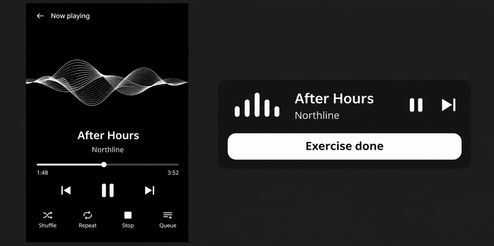

# InShape music player for MP3s without cover art

Implementation plan, 18 November 2026. Status: proposed, awaiting implementation.

Give the full player a silver wave that moves while a song plays. In the mini-player, five small bars carry the same idea into the workout. A folder of ordinary MP3s with no embedded images must produce the complete design from the first frame. The visuals indicate playback activity. They use a designed motion pattern independent of the song's loudness, tempo and sample data.



The left panel is the visual reference for the ribbon. The right panel enlarges the workout footer to make the bars visible. Use the app's dimensions below for implementation. The mockup's Queue icon is illustrative. The app already shows the queue as a list below the controls. Keep that list and the existing control order.

## 1. Integration points

| Source | Verified behavior | Implementation decision |
| --- | --- | --- |
| [PlayerScreens.kt](../../../app/src/main/java/com/emmah/inshape/feature/music/PlayerScreens.kt), `NowPlaying` | A 152 dp square cover sits in the first item of a scrolling column above the title, artist, seek slider, transport controls and queue. When the current song is absent, the screen displays “Nothing is playing”. | Replace that one cover call with a full-content-width ribbon, 152 dp high. Retain the surrounding column, screen padding and empty state. |
| Same file, `MiniPlayer` | The clickable leading region contains a 56 dp cover and the two-line metadata block. Pause/play and next are separate buttons. A missing song removes the row. | Replace the cover with a 56 × 56 dp drawing. Keep the parent click target, text widths, button hit areas and row padding. Use this component for both mini-player locations. |
| [AppNavigation.kt](../../../app/src/main/java/com/emmah/inshape/navigation/AppNavigation.kt) and [WorkoutScreen.kt](../../../app/src/main/java/com/emmah/inshape/feature/workout/WorkoutScreen.kt) | The Music mini-player opens Now playing. The workout mini-player opens the music chooser. In the workout, font scale ≥ 1.3 or window height < 560 dp moves the row into scrolling content. The keyboard hides the player and fixed workout action. | Keep placement and tap handling at their current call sites. The miniplayer graphic travels with its existing row. |
| [MusicPlayback.kt](../../../app/src/main/java/com/emmah/inshape/feature/music/MusicPlayback.kt) | `PlaybackState.playing` comes from Media3's `isPlaying`. `playRequested` can be true during buffering. The full player polls position every 350 ms during real playback. | Drive motion from actual playing state. Keep the seek position and the visual animation on separate clocks. |
| [MusicArtwork.kt](../../../app/src/main/java/com/emmah/inshape/feature/music/MusicArtwork.kt) | The song artwork path can decode an embedded picture and falls back to a bundled record-groove image. Playlists resolve their own cover images. | Use the new graphic for every song in these two player slots, including songs that happen to contain an image. Keep playlist browsing and its existing artwork resolution. |

The only production behavior change is drawing the two player graphics. The existing folder picker, MP3 index, metadata labels, player service, media notification, queue persistence and audio output already serve this flow. No additional permission, image download, audio capture, audio processing, library or database change is needed.

## 2. Draw the two views

Use Compose Canvas and the current theme. Treat the measurements below as implementation starting values. The acceptance targets are the reference silhouette, legibility in both themes, and stable layout across playback states.

### Full player

1. Fill the available content width inside the current 20 dp screen insets. The canvas will be 280 dp wide on a 320 dp screen where those insets are the only horizontal deductions. Use the measured width for all horizontal positions. Keep the 152 dp height at all font scales.
2. Draw directly on the existing page surface. Leave a quiet band of background above and below the wave. Set the centerline halfway down the canvas and cap the largest excursion at 36 dp on either side. Title, artist and controls stay below this area.
3. Draw nine smooth, unfilled curves from left to right. Aim for two unequal lobes with a crossing between them and gently tapered ends, as in the reference. Use roughly 1 dp strokes with rounded ends. Use the theme's primary text color for the clearest strands and lower opacity for the others. Start at 45–85% opacity. Dark mode should read as silver on near-black and light mode as graphite on the page surface.
4. A reproducible first pass can use the following geometry. Normalize horizontal position `x` to 0–1, strand position `s` to −1 through +1 across the nine curves, and loop phase `p` to 0–2π. Evaluate in radians. Convert the final vertical offset from dp to pixels once per scale factor. Sample at intervals of at most 3 dp horizontally and include the right endpoint.

   ```text
   envelope = sin(π × x) × (0.82 + 0.18 × cos(2π × x − 0.6))
   carrier  = 0.55 × sin(3π × x − p + 0.70 × s)
   spread   = 0.42 × s × sin(2π × x + p)
   y        = centerY + amplitude × 36dp × envelope × (carrier + spread)
   ```

   Start a preview at phase 0.7 radians. Tune the strand separation against the reference at phone size. Keep both ends anchored to the centerline, the drawing inside its bounds and the loop seamless. At rest draw one quiet horizontal stroke. Drawing nine coincident strokes would make the resting line unnecessarily bright.

### Music and workout mini-player

1. Center five vertical bars within the former 56 dp artwork slot. Start with 4 dp wide bars, 3 dp gaps and rounded ends. The group spans 32 dp, leaving 12 dp of clear space on each side. Draw on the row's existing surface.
2. Align the bars to a common lower baseline 40 dp from the top of the slot. Use peak heights of 14, 22, 30, 24 and 16 dp from left to right. The middle bar is tallest at its peak. Vary the heights smoothly with a phase offset of about 0.8 radians per bar. One possible height function is `4dp + amplitude × (peak − 4dp) × (0.5 + 0.5 × sin(p + offset))`.
3. Use the theme's primary text color. Animate height only. The glyph's slot, baseline, text and buttons stay fixed. At rest draw five short 4 dp marks along the baseline. With reduced motion enabled, use a fixed unequal-height shape during playback so the two states remain visually distinct.

## 3. Motion and state transitions

| Situation | Expected result |
| --- | --- |
| No current song | Render the existing empty state on Now playing. Omit the mini-player. Start no visual animation. |
| Track selected, paused or restored paused | Show the resting line or five low marks immediately. App launch and navigation must never start audio. |
| Playback starts or resumes | As soon as `playing` becomes true, increase amplitude from the current value to 1 over roughly 220 ms. Use a smooth, continuous 3.6 s cycle for the ribbon and a livelier 1.6 s cycle for the mini-player. |
| Pause, buffering, end or audio-focus interruption | When `playing` becomes false, freeze the phase, ease amplitude to 0 over roughly 280 ms, draw the resting shape and stop frame work. Keep the existing buffering message and transport logic. A requested play operation alone must never start the motion. |
| Error or recovery | Preserve the existing error message. Use the actual playing state even if an earlier error is still displayed. If the player clears the current song, switch directly to the existing empty state. |
| Rapid play/pause, seek, skip or queue jump | Reverse an in-flight amplitude transition from its current value. Seeking and 350 ms position updates must never restart the loop. Update song text through the existing state flow. Allow phase continuity while tracks change during uninterrupted playback. |
| System animator duration scale is zero | Skip both the repeating motion and the settling transition. Show a fixed ribbon or fixed tall-bar pattern while playing and the resting form while paused. Re-evaluate when the system setting changes. |
| The graphic leaves composition or the screen goes to the background | Cancel its animation work. When visible again, render from the current playback state. The media service continues to own playback independently. |

## 4. Implementation sequence

1. Add the two internal drawing composables next to `PlayerScreens.kt`, for example in `PlaybackVisuals.kt`. Give each the actual playing flag and a layout modifier. Keep shared phase/amplitude logic local to this file. The drawing functions need only size, color, phase and amplitude. Use the project’s current Compose and lifecycle dependencies.
2. Run the animation in the UI lifecycle. Gate continuous phase advancement on active playback, enabled system animations and a foreground host. Use a single phase per visible graphic for all of its strokes. Read per-frame values in the drawing phase so the track title, queue and workout fields do not recompose for each frame. Reuse the paths between draws. Draw the settled and reduced-motion branches without an infinite transition. Keep phase local and transient.
3. Swap the two `MusicArtwork(song.uri, …)` calls for the corresponding graphics. Preserve the existing `PlayPause` logic based on `playing || playRequested` so users can still cancel pending playback. Keep the seek slider usable for seekable tracks with known duration. The wave has no tap, drag or seek action.
4. Keep the graphics decorative in the accessibility tree. The title, artist, player-open action and labeled transport buttons already describe the usable interface. Avoid per-frame semantics updates and extra TalkBack focus stops. Keep the existing 48 dp mini-player transport targets.
5. Check both composables through their normal entry points before adjusting visual constants. Limit tuning to the waveform, bar geometry, opacity and speed. Use the approved image for those decisions and the existing UI for text, buttons and spacing.

## 5. Verification and handoff

**Host checks.** From the repository root in PowerShell, run the following after implementation. Run sequentially on a memory-constrained machine. These commands compile the app and test APK, run host unit tests and lint the debug variant. They do not install anything on a phone.

```powershell
.\gradlew.bat :app:assembleDebug :app:assembleDebugAndroidTest --console=plain
.\gradlew.bat :app:testDebugUnitTest --console=plain
.\gradlew.bat :app:lintDebug --console=plain
```

**Focused regression coverage.** Extend [MusicUiTest.kt](../../../app/src/androidTest/java/com/emmah/inshape/MusicUiTest.kt) with the missing path from Music home through the mini-player into Now playing. Start a playlist, open the player, pause, resume, skip, verify the current song, then go back. Reuse the existing workout chooser test for the distinct workout tap behavior. The [demo catalog](../../../app/src/debug/java/com/emmah/inshape/demo/DemoMusic.kt) supplies artwork resource URIs. It covers navigation but cannot establish how a real coverless MP3 plays.

For motion itself, use a focused Compose rendering test with a controlled test clock. Draw the same bounded graphic at two known points within the cycle and confirm its pixels differ while playing. Pause, advance beyond the settling duration, then compare two later frames and confirm they match. Sample the graphic bounds only, excluding the seek time and workout timer. Exercise both graphics and check the fixed reduced-motion pattern. Keep test clock control in the test harness and use existing transport semantics for interaction assertions.

**Physical acceptance.** Device verification is pending until the owner's Pixel is available for this task. Leave the phone reserved for the other app untouched and do not launch an emulator. On the Pixel, use a local MP3 confirmed to contain no embedded image, record the initial display and animation settings, and restore any temporary overrides afterward.

| Check | Pass condition |
| --- | --- |
| Actual local file | Select its folder through Music, play the track and open Now playing. Audio plays, the ribbon appears and the seek control advances. Pause and resume affect sound and motion together. No artwork selection is required. |
| Full player | Ribbon fits within the page and looks continuous across a loop boundary. Title, artist and slider stay still. Seek, next, previous, queue selection and Back retain their existing behavior. |
| Workout | Start or resume a workout while music plays. The bars fit above Exercise done at normal size. Pause/play and skip work independently. Tapping the title opens the chooser. Cancel returns to the same exercise. Open a numeric set field, verify the player hides, close the keyboard and verify the row returns. |
| Width, font and theme | Check 390 dp / 100%, 320 dp / 100%, 390 dp / 200% and **320 dp / 200%** in both Light and Dark. On both player sizes check the silhouette, text boundaries, reachable controls and absence of overlap. At 200% verify the workout player is reachable by scrolling and the fixed exercise action is usable. |
| Reduced motion and TalkBack | At animator duration scale zero, both active graphics remain static and distinguishable from paused. TalkBack can open the player or chooser and activate play/pause and next. It skips the decorative graphics. |
| Lifecycle | Background the app during playback and return. Sound follows the existing service behavior, the displayed state is current and only the visible player animates. Stop playback and confirm the mini-player disappears. Reopen a restored paused queue and confirm it stays visually still. |

Record the commands actually run, the device and display combinations actually checked, and any blocked runtime checks. Keep one representative capture of each player if visual evidence is collected. The concept image and earlier music-player verification describe the target and the baseline respectively. Runtime acceptance requires the implemented build.
