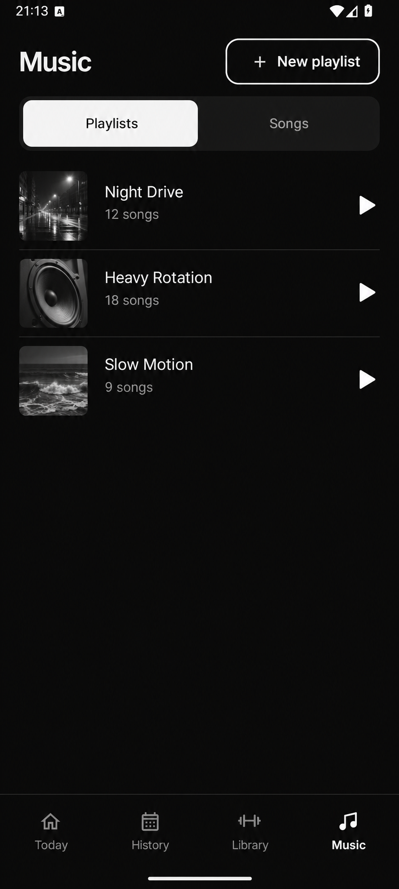
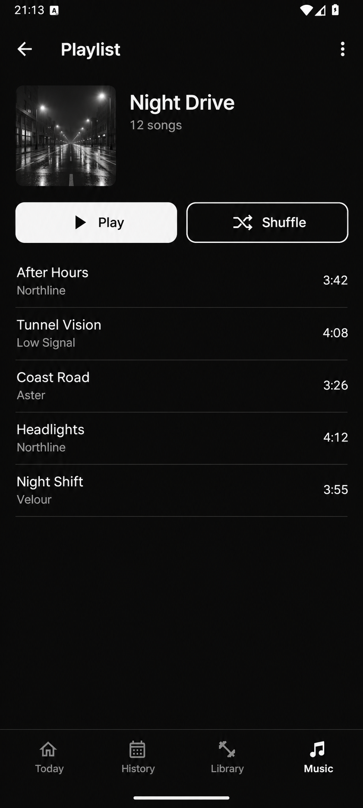
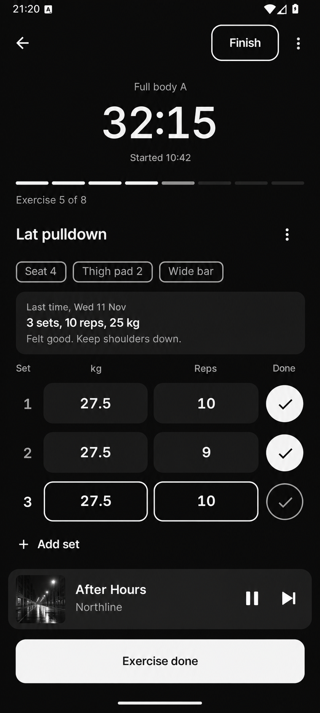

# InShape local music player

Implementation and visual acceptance plan, 18 November 2026.

Give Music a permanent fourth place in the bottom navigation. The user chooses what to hear each time. One tap on a playlist's play button starts it. Opening a playlist lets the user start with a particular song. The same player continues through a workout, in another app and with the screen locked. A workout, exercise or routine never owns the music selection. Starting or finishing a workout is independent of starting or stopping playback.

## 1. The three screens to build

The following PNGs are the original approved design targets for this plan. Use them directly for screenshot comparison. They show dark appearance, English labels and normal font size. Each is **841 × 1870 pixels**, including the system bars. The measurements below are approximate landmarks in the reference canvas. Implement the layout with Compose dimensions, text styles and insets. The reference status-bar time, battery, gesture handle, sample artwork and track names belong to the example content.

### A. Music home



| Region | What to build | Interaction |
| --- | --- | --- |
| Header | Left-aligned **Music** title. Outlined **+ New playlist** button aligned right. Match the Library header's side padding and visual weight. | New playlist opens the name and song selection flow. |
| Switch | A single charcoal segmented surface spanning the content width. **Playlists** on the left, **Songs** on the right. In dark mode the selected segment is almost white with dark text. | Open Music on Playlists on first visit. Preserve segment and scroll position when returning. |
| Playlist rows | Flat list on the page background. Square cover with subtly rounded corners, name and song count stacked to its right, a single white play triangle at the trailing edge. Hairline between adjacent rows. | Cover, name and count open the list. The trailing button starts the entire list immediately and leaves the user on Music home. These are separate hit targets. |
| Lower portion | In the pictured idle state the space below the three rows is plain background. The bottom bar is pinned below that space. | A long list scrolls above the bar. An empty library offers an action to choose music. |
| Main navigation | **Today**, **History**, **Library**, **Music**, in this order, each with one icon over its label. Use the existing icons for the first three, and a music note for Music. Active Music is bright with a stronger label. | Preserve the existing tab save/restore behavior. Expose the selected destination to accessibility services. |

For the reference capture, show **Night Drive / 12 songs**, **Heavy Rotation / 18 songs**, **Slow Motion / 9 songs** in that order. Use neutral cover art depicting a wet street, a speaker and waves. At reference size, the left content edge is around x=40, the header button ends around x=800, the segmented control starts around y=202, the first cover starts around y=360 and the bottom divider sits around y=1670. The first cover is about 144 px square. The list occupies the upper part of the screen even when there are only three items. Use the singular form for one song.

### B. Playlist detail



1. Use a compact pushed header with a back arrow, **Playlist** and a trailing overflow menu. Render this header exactly once. Keep the four-tab bar visible, with Music selected.
2. Place a square cover at the left and the playlist name and song count together on its right. Align the title block with the upper part of the cover. Use the same cover identity in Music home and playlist detail.
3. Place **Play** and **Shuffle** in one equal-width row below the cover. Play is filled with a leading triangle. Shuffle is outlined with a leading shuffle icon. In dark mode the filled button is light. Both actions start playback while preserving the current screen.
4. Render tracks as flat, unboxed two-line rows. Title comes first, artist below in secondary text, duration aligned to the right and vertically centered. Use subtle dividers, consistent time formatting and no leading track numbers. Tapping a row starts that track and continues through the list in its saved order.
5. The top overflow exposes **Add songs**, **Edit playlist**, **Rename** and **Delete playlist**. Edit mode supplies selection, removal and reordering. Keep these controls out of the resting layout. Back returns to the same list position on Music home.

| Visible reference track | Artist | Duration |
| --- | --- | --- |
| After Hours | Northline | 3:42 |
| Tunnel Vision | Low Signal | 4:08 |
| Coast Road | Aster | 3:26 |
| Headlights | Northline | 4:12 |
| Night Shift | Velour | 3:55 |

At reference size the art occupies approximately x=38–266 and y=202–428. The action row starts around y=469, with the first track title around y=618. The image illustrates five visible entries and a total count of twelve. Derive the count from real memberships and render all entries in the scrollable list. For a live twelve-song fixture, the remaining songs may also occupy space below the pictured five. Do not enforce the illustration's blank area with a five-row limit or spacer.

### C. Active workout with music



Keep the existing workout header, elapsed clock, progress, exercise controls, previous performance, set fields and **Add set**. The fixed footer has two rows. The compact player is first, followed by the existing full-width **Exercise done** button. The workout is a pushed screen with its own navigation. The main tab bar is hidden here.

| Player element | Visual target | Action |
| --- | --- | --- |
| Container | Low charcoal surface across the available width, softly rounded corners, small horizontal inset. It reads as a secondary control beside the bright workout action. | Show for a current track, including paused playback. Browsing with an empty queue leaves the original workout footer available. |
| Leading block | Small square cover at left. Title and artist on separate lines. Reference content is **After Hours** and **Northline**. | Tapping the cover or text opens the Music chooser over the workout. Back or selecting new music returns to the same exercise and set position. |
| Trailing controls | Two separate white glyphs for pause and skip next, aligned centrally. | Toggle between play and pause using session state. Skip advances once. Disable skip when there is no next track. |
| Workout action | The existing button retains its label, sizing and behavior. | **Exercise done** records workout progress. Finishing a workout allows music to continue until the user ends playback. |

In the PNG, the mini-player occupies roughly x=21–820 and y=1492–1651. The main workout button begins around y=1677. Match the modest gap and the alignment of the text block and controls. Keep **Up next** reachable in the scrollable workout content when applicable. When the on-screen keyboard is editing a set, respect the existing footer-hiding behavior for both rows. On very short screens or at large text sizes, give the set editor usable space by moving the player into the scrollable content if the pinned pair would crowd out the inputs.

## 2. Visual rules shared by the implementation

- Use InShape's bundled Inter typography, Material text roles, theme colors and existing button shapes. The dark palette already provides the near-black background (#0B0B0B), charcoal surface (#1A1A1A), divider (#2A2A2A), primary text (#F5F5F5) and secondary text (#A3A3A3) seen in the references. System and Light appearance use the same hierarchy with the corresponding theme tokens.
- Start with `Dimens.screenPadding` (20 dp), `itemGap` (12 dp), `innerSmall` (8 dp), `line` (1 dp) and `touch` (48 dp). Use the existing navigation height rules, including their large-text alternative. Starting sizes for covers are 64 dp for playlist rows, about 104 dp for the detail header and 48 dp for the mini-player. Compare the rendered proportions to the PNGs before finalizing only the music-specific sizes.
- Use a single paragraph-width column bounded by the existing maximum page width. Align the header, segmented control, list content and playlist actions to shared edges. Render native system bars using the app's existing edge-to-edge handling. Apply each inset once.
- Artwork is the only picture in these screens. Use embedded artwork where available, scaled and cropped to a square, with a restrained grayscale treatment for this design. Fall back to a neutral tile with a music note if artwork is missing. A playlist uses the first track with available artwork in saved order. Keep the sample songs and artwork in test/demo fixtures only.
- Keep decorative badges, vertical edge stripes, interpunct separators, large hero banners and extra card containers out of the design. Active, paused and selected states must also be identifiable by icon, text or semantics.
- Use two distinct accessibility actions for the playlist row and play button, for example **Open Night Drive** and **Play Night Drive**. Expose artist and duration with the track title, announce selected segments and provide labels for icon-only controls. Keep 48 dp minimum touch targets. At 200% font scale allow text and containers to grow, wrap the header action below its title or stack the Play and Shuffle buttons when required. Keep controls reachable and the full song title available to TalkBack.

## 3. Music selection and supporting flows

These flows complete the player around the three reference states. Build them with existing InShape list, field, sheet and button patterns.

| Starting point | User action | Expected result |
| --- | --- | --- |
| First visit, empty library | Open Songs, then **Choose music folder**. Make the same action reachable from the empty Playlists screen. | Android's folder picker opens. After selection, show progress and then songs from that folder and its subfolders. Cancel returns to the same screen and starts no audio. |
| Songs | Search by title or artist, then tap a song. | Start from that song in the visible result order. A later search does not alter the playing queue. Song actions include **Play next** and **Add to playlist**. Offer folder selection and refresh from this segment. |
| New playlist | Enter a nonblank name, select songs, then save. | Save the name and selected tracks together, preserving selection order. The user can save an empty named list and add tracks later. Cancel discards the draft. |
| Playlist detail | Add several songs, reorder tracks, remove a track, rename the list or confirm deletion. | Persist each confirmed edit. Offer accessible move up/down actions alongside any drag affordance. Removing a song from a playlist only removes that membership. Deleting a playlist removes its memberships and keeps the audio files. |
| Active workout, queue empty | Open **Music** from the existing workout overflow. | Show the same Playlists/Songs chooser over the workout. Tap a playlist's play triangle or a single song to start and dismiss. Tap a playlist's title to inspect tracks before choosing. |
| Active workout, music playing | Tap the mini-player's cover or title, then tap another playlist's play triangle. | Replace the queue and return immediately to the same workout. Dismissing the chooser without selecting anything keeps the current track and position. |
| Music tab, queue active | Tap the current-track strip above the main navigation. | Open **Now playing** with cover, title, artist, elapsed/total time, seek slider, previous, play/pause, next, shuffle, repeat and the queue. Show the strip on music screens only when a current item exists. The two idle reference images have no strip. |

Define playback consistently. **Play** starts at the first available track in saved order. **Shuffle** builds a shuffled traversal with a randomly selected first track. **Play next** inserts after the playing item in the effective play order, including while shuffled. If the queue is empty, it sets the first item ready to play. Repeat cycles through Off, All and One. Previous restarts the current track after three seconds of playback and otherwise moves to the previous track when available. At the end of the queue with repeat off, stop advancing and offer replay. A deliberate new selection replaces the current queue. A library refresh, playlist edit or navigation event leaves the current queue snapshot intact.

## 4. Where the feature fits in this repository

| Current owner | Scoped implementation work |
| --- | --- |
| `app/src/main/java/com/emmah/inshape/navigation/AppNavigation.kt` | Add Music to the existing tab, label and icon lists. Add a Music root and playlist-detail route keyed by playlist ID. Use a common selected-tab rule for icon, label and bar visibility so the detail route selects Music. The existing `isMain` logic also affects pushed headers. Explicitly handle the detail header and test for a single back arrow. Keep History's query route, its Progress view and Settings routing working. |
| `feature/library/LibraryScreen.kt`, `ui/components/`, `ui/theme/` under the same package | Follow the Library header and segmented-control pattern. Reuse `SegmentedControl`, `PrimaryButton`, `OutlineButton`, existing list/divider styles and theme dimensions when they match the PNG. Use a lazy list for large song collections and a stable item key for each row. |
| `feature/workout/WorkoutScreen.kt` | Extend the existing `Page(bottomBar = bottomAction)` and workout overflow. Open an in-place chooser with its own list/detail state so the workout remains composed. Preserve scroll, unfinished set input, timer and back behavior. Gate the controls to active workout logging, including an active workout with no exercises yet. |
| `AppContainer.kt` and new code under `feature/music/` | Provide a small, lazily opened music store, Music UI state and a Media3 controller connection. Retain the current single-module architecture and manual construction. Tie demo/test storage to the existing isolated container identity. Provide deterministic UI playback state in isolated demos so a fixture never connects to the user's live session. |
| `gradle/libs.versions.toml`, `app/build.gradle.kts`, `gradle/verification-metadata.xml`, `app/src/main/AndroidManifest.xml` | Add the ExoPlayer and session artifacts with one stable Media3 version compatible with the actual build. Verify new artifact checksums through the project's existing dependency-verification workflow. Declare the playback service and required foreground-service permissions. Inspect the merged release manifest to preserve the offline app contract, including any permissions contributed by dependencies. |
| `feature/workout/ActiveWorkoutNotifier.kt`, `transfer/BackupArchive.kt`, `transfer/BackupService.kt` | These are integration boundaries. Give the media session a distinct notification ID and channel from the workout. Keep the device-local music index and URI grants separate from portable journal backups. Verify that restoring a journal on the same device preserves the music library and old archives remain readable. |

The inspected project uses Compose, Navigation Compose and Room, minSdk 26, compileSdk and targetSdk 37. The app already branches layout for large text and its workout action already responds to IME visibility. The project guide records the build/test entry points. Google's release table listed Media3 1.11.1 as stable on the plan date. Resolve and verify the compatible stable version at implementation time. [Project guide](../../../PROJECT.md) and [Media3 releases](https://developer.android.com/jetpack/androidx/releases/media3)

## 5. Storage, playback and recovery

### Local library and playlists

1. Use the Storage Access Framework folder picker and persist the returned read grant before saving a music source. Read audio through content URIs. Index the selected local tree off the main thread, with cancellation. Keep audio in its original location. A cancelled picker or failed replacement preserves the previous usable source. The system picker can expose cloud providers, so request local-only locations and present unavailable content as unavailable. [Android shared documents](https://developer.android.com/training/data-storage/shared/documents-files)
2. Store the music catalog in a small, separate Room database scoped to the container. Use a source record for the tree URI, track records keyed by stable document identity within the source, playlists with stable IDs and names, and ordered membership records referencing playlist and track IDs. Store title, artist, nullable duration and availability for each track. Keep a unique membership per playlist and track. Apply multi-add, remove and reorder changes in transactions. This keeps music edits independent of the journal's version-1 schema, snapshot and backup format.
3. Use provider metadata and embedded tags, falling back to the display filename and **Unknown artist**. Show an em dash for unknown duration and enable seeking when the player reports a seekable timeline. Obtain artwork lazily with bounded thumbnail sizes. Keep large artwork blobs out of row queries.
4. Rescanning the same folder updates existing records without duplicating songs or memberships. Mark items missing only after a successful complete scan of their source. If access is revoked or an SD card disappears, retain the playlist and order, offer **Choose folder again** and restore availability when the same documents return. Replacing the folder keeps unresolved memberships visible for deliberate removal.
5. Treat a saved playlist as a collection and the queue as the current listening order. Resolve each playable queue item to a local, authorized track ID. Keep a lightweight snapshot of queue order, current item, position, shuffle and repeat on meaningful changes. Restore paused after process death. Normal screen rotation or returning from the background reconnects to the existing service and reflects actual playing state.

### One player and one media session

1. Let a `MediaSessionService` own one ExoPlayer and one media session. The Compose screens observe a lifecycle-aware `MediaController`. Route the Music tab, workout controls, media notification, lock screen and headset buttons to the same session. Browsing, scrolling and composing a row must never call play. Release controllers and listeners when their owners close, and release the player and session in service teardown. [Android background playback](https://developer.android.com/media/media3/session/background-playback)
2. Start audible playback from an explicit user action. Declare `FOREGROUND_SERVICE`, `FOREGROUND_SERVICE_MEDIA_PLAYBACK` and the `mediaPlayback` service type. Configure session access for InShape and trusted system media controls. Resolve track IDs within the local catalog before accepting media-item requests. Connect to the existing service after configuration changes. Do not launch a second player from another screen or use the workout notification permission prompt to authorize music.
3. Set audio attributes for music, delegate audio focus to ExoPlayer, and enable noisy-output handling. Pause on headphone disconnection. Respect permanent focus loss and manual pause during a transient interruption. Derive controls from actual session state including buffering, ended playback and available commands. Disable seeking when the duration or timeline does not permit it.
4. Use Media3 queue operations for ordered playback, seeking, shuffle and repeat. Serialize queue replacement and ignore stale asynchronous resolutions when the user rapidly selects two lists. The most recent explicit choice wins. If an item is unreadable, try the next available item at most once per candidate. When all items fail, stop and show a recoverable message. [Media3 playlists](https://developer.android.com/media/media3/exoplayer/playlists)
5. Exercise **MP3, AAC in M4A, FLAC, PCM WAV, Ogg Vorbis and Opus in Ogg** with small known-good local samples. Container and codec both matter. Report tested combinations and device/API levels. For a damaged file or unsupported encoding, identify the affected song and keep the rest of the library usable. [ExoPlayer format support](https://developer.android.com/media/media3/exoplayer/supported-formats)

## 6. Implementation order and exit checks

| Step | Deliverable | Confirm before moving on |
| --- | --- | --- |
| 1. Establish the visual states | Add Music navigation, the home and detail compositions, and an isolated preview/demo for each of A, B and C. Use reference data only in those fixtures. | Check the exact tab order, headers, hero artwork, row alignment and workout footer against the original PNGs. Opening playlist detail leaves Music highlighted. |
| 2. Connect local files | Implement folder selection, persisted grants, indexed song metadata and durable playlist CRUD. Replace the production screen's fixture inputs with real data. | Select a folder, create a playlist, reorder songs, reopen the app and verify the saved order. Cover an empty folder, cancelled picker, revoked grant and repeated refresh. |
| 3. Add audible playback | Add Media3, the service, session, controller, queue commands and active-track UI. | Play a playlist with one tap, start a specific song, seek, shuffle and repeat. Verify the audio, current title and controls remain in sync after locking and unlocking the screen. |
| 4. Integrate the workout | Attach the compact player and chooser to the current workout. Handle pause, skip, idle access and keyboard visibility. | While logging a set, start or change playlists, return and finish the exercise. Confirm one saved set, correct reps/weight, the same workout ID and continuous elapsed time. |
| 5. Verify and document | Run the checks below. Update the existing navigation description in README and the project guide when the feature actually ships. | Record the final three dark screenshots, devices and test results. Report separately any physical behavior that could only be checked on an emulator. |

### Validation matrix

| Area | Procedure and pass condition |
| --- | --- |
| Visual fidelity | Capture the three reference states in English at normal font size, dark appearance and a matching portrait aspect ratio. Compare side by side at equal content width. Check A's row art and trailing play targets, B's cover/title and paired actions, C's mini-player and primary button. Align app content independently from status icons and system insets. Explain any deliberate accessibility or live-data difference. |
| Responsive layout | For all three screens test **normal width at 100%**, **320 dp at 100%**, **normal width at 200%** and **320 dp at 200%**, in Light and Dark. Use the project's usual normal-width phone configuration and record it. Validate long titles, action labels, four tab labels, scrolling, IME open/closed and usable set-entry area. Run TalkBack across row body, play button, tabs, mini-player and accessible reorder controls. |
| Navigation and interaction | Extend existing Compose navigation and layout tests. Cover playlist row versus trailing play, Back from detail, tab re-entry, choosing music from an idle workout, changing lists from a playing workout and cancellation. Verify that opening the chooser alone neither restarts audio nor commits a set. Test rapid consecutive playlist selections. |
| Data and queue | Test stable reindexing, transactional reorder, duplicate selection, missing documents, queue snapshot after list deletion, current-song removal from a saved list, shuffle plus Play next, repeat-one/all/off and restoration of paused playback after process death. Run on isolated music storage. Verify the normal journal starts empty on a fresh install. |
| Real playback | On API 26 and a modern target-compatible device/emulator, exercise the six format fixtures through the production picker and service. Confirm duration, advancing playback and seeking where supported. On a physical phone check audible output, lock-screen controls, Bluetooth pause/skip/disconnect, focus interruption and concurrent workout/media notifications. Record the device and results for each check. |
| Regression | Exercise Today, History including Progress, Library and Settings. Launch an active workout via its existing notification, test keyboard entry and **Exercise done**, and finish a workout while music plays. Restore an existing journal backup and verify journal records plus the independent local playlists. |

Run the repository's Gradle entry points from the project root. First use focused tests during development, then run the affected suites and the build checks against the integrated change. For instrumentation, select the intended connected test device and configure the layout matrix explicitly. A compiled test APK alone does not exercise any screen.

```powershell
.\gradlew.bat :app:testDebugUnitTest :app:lintDebug :app:assembleDebug :app:assembleDebugAndroidTest --console=plain
.\gradlew.bat :app:connectedDebugAndroidTest --console=plain
```

Acceptance requires both the reference-matched screens and this end-to-end result: with a workout open, choose any playlist, hear it start, pause or skip a song, choose a different playlist, and return to the same exercise with the recorded sets intact. Retain the three final comparison screenshots and a concise check record. Label unexecuted checks explicitly.
